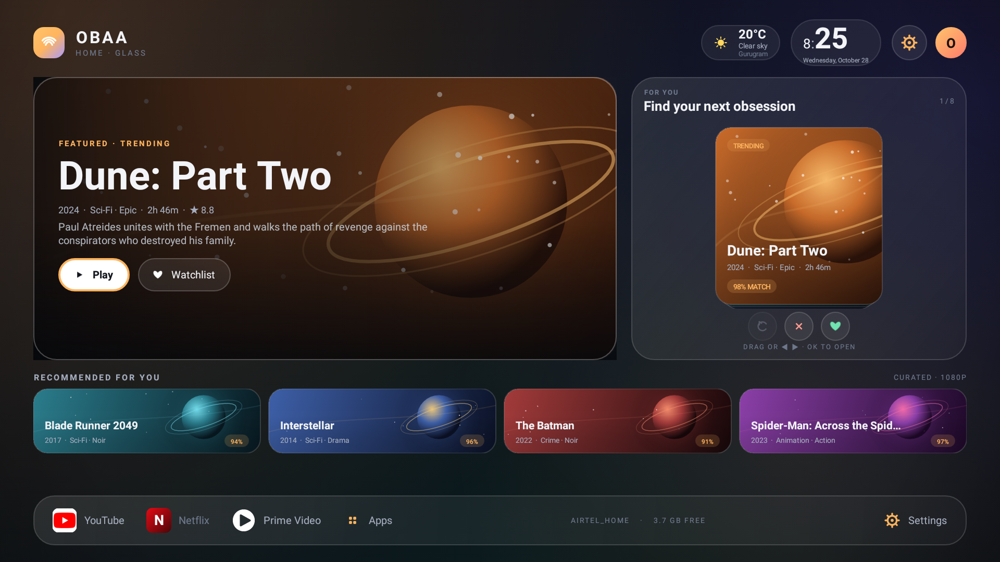
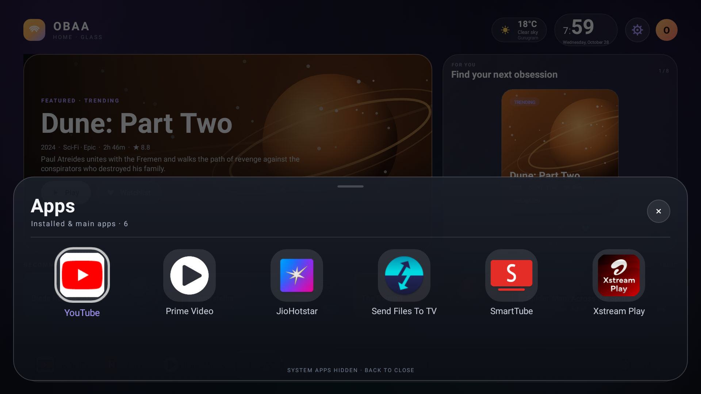
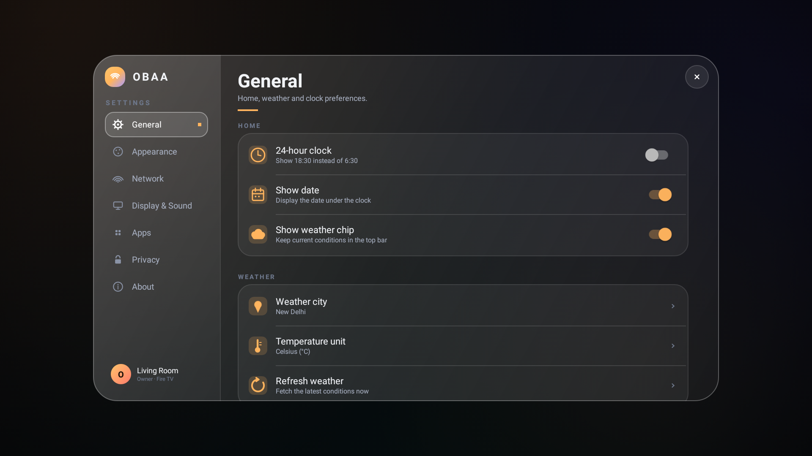
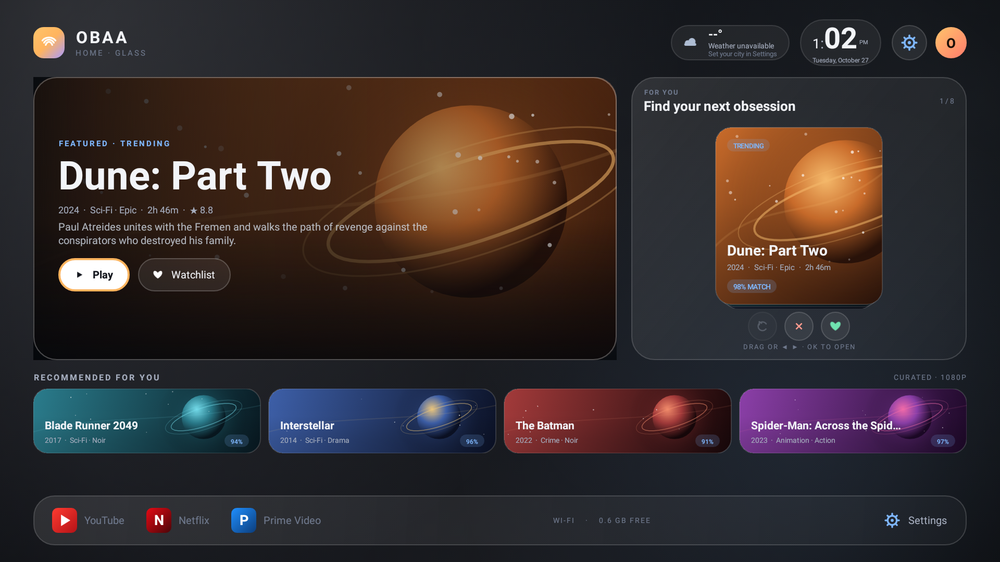
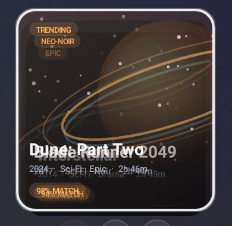

<div align="center">

# 🌌 OBAA Home

### A calm, glass-first launcher for Fire TV

**Midnight glass. Amber light. Every app one press away.**

[](https://www.amazon.com/fire-tv)
[](https://github.com/learnerarchitecture-debug/Fire-tv-/releases)
[](https://github.com/learnerarchitecture-debug/Fire-tv-)
[](docs/BUILD.md)
[](LICENSE)

[Features](#-highlights) · [Screenshots](#-gallery) · [Install](#-quick-start) · [Fire TV Home](#-make-it-the-fire-tv-home) · [Build](#-build-from-source) · [Docs](#-documentation)

</div>

---

> **OBAA Home** is a full-screen Apple-TV-inspired launcher built for the Amazon Fire TV. It pairs a soft glass interface with a fast D-pad flow, a curated app dock, a Tinder-style recommendation deck, and a bottom app drawer that keeps every launchable app close without exposing Fire OS system apps.



---

## ✨ Highlights

| | |
|---|---|
| 🧊 **Glass-first design** | Midnight, Graphite and Aurora themes with five accent colours and adjustable glass strength. The default is **Midnight / Amber / 62%**. |
| 🕰️ **Beautiful clock** | Large minutes, optional 24-hour time, date and a live weather chip. |
| 🎬 **Recommendation deck** | Swipe or use the D-pad to save, pass and undo movie picks. Saved picks stay in a local watchlist. |
| 🚀 **Curated dock** | YouTube, Netflix and Prime Video in the footer. Missing apps keep a graceful fallback tile. |
| 📱 **Bottom app drawer** | A translucent six-column sheet with launchable third-party apps and curated main apps. Main apps are pinned first; Fire OS system apps are hidden. |
| 🎛️ **Full settings** | General, Appearance, Network, Display & Sound, Apps, Privacy and About panes, all reachable from the D-pad. |
| 🏠 **Fire TV Home support** | A lightweight usage-stats watcher detects the stock launcher and brings OBAA Home to the front. One-time ADB app-op grant; no accessibility service or root. The stock launcher remains installed and recoverable. |
| 🎨 **On-device artwork** | Icons, posters and the aurora background are drawn locally. No artwork download is required. |
| 🔒 **Local by default** | No analytics. Weather comes directly from Open-Meteo. Preferences live in the `aurora` preference file. |

---

## 📸 Gallery

| Home | App drawer |
|:---:|:---:|
|  |  |

| Settings | Graphite theme |
|:---:|:---:|
|  |  |

<div align="center">

**Recommendation deck**



</div>

---

## 🚀 Quick Start

### Requirements

- Amazon Fire TV on **Fire OS 5.1.1 / Android 5.1 (API 22)** or a compatible Fire OS build
- ADB access to the Fire TV
- The prebuilt **`OBAAHome.apk`** from this repository

### Install

```bash
adb connect <fire-tv-ip>:5555
adb install -r OBAAHome.apk
```

The package ID is **`com.aurora.home`** and the app name is **OBAA Home**.

### First launch

```bash
adb shell monkey -p com.aurora.home -c android.intent.category.LAUNCHER 1
```

Or open **OBAA Home** from the Fire TV app list.

> The app drawer is intentionally not exported. Open it from the home screen dock: **Down → Down → Right → Right → OK**. Press **Back** to close it.

---

## 🏠 Make it the Fire TV Home

Fire OS 5.1.1 does **not** provide a normal “default launcher” picker. The physical Home key is handled by `FireTVKeyPolicyManager`, which starts the stock launcher directly. Fire OS also sends a protected `CLOSE_SYSTEM_DIALOGS` broadcast with `reason=home`, but this firmware does not define `DISABLE_KEYGUARD` for third-party apps, so OBAA cannot receive that broadcast.

OBAA Home therefore uses a lightweight usage-stats watcher. While the screen is on, `HomeKeyWatcherService` asks `UsageStatsManager` which package was most recently used. When that package is `com.amazon.tv.launcher`, OBAA Home is started on top. On Fire OS 5.1.1 the system hides other apps from `getRunningAppProcesses()`, so the usage-stats route needs a **one-time ADB app-op grant**. The stock launcher is never disabled and can be restored at any time.

Third-party accessibility services are **not** used. Fire OS 5.1.1's `A11yAuthorizer` blocks providers that are not signed by Amazon (`trust=false`).

### How the Home hook works

- **`HomeKeyWatcherService`** runs as a small foreground service.
- It polls every 500 ms while the screen is on.
- `UsageStatsManager` reports the most recently used package; when it is the stock launcher, the watcher opens `HomeActivity`.
- On firmware that does not filter the process list, `getRunningAppProcesses()` is kept as a faster in-memory check.
- Launches are debounced for 1.2 s, and polling is skipped whenever OBAA Home is already visible.
- On Fire OS builds that do define `DISABLE_KEYGUARD`, it also listens for the `CLOSE_SYSTEM_DIALOGS` Home broadcast as a faster path.
- The stock launcher is **never disabled** and can be restored at any time.
- The stock launcher may flash briefly before OBAA Home appears.

### Enable

Installing and opening OBAA Home starts the watcher automatically. Grant Usage access once, then enable it explicitly:

```bash
# One-time grant: lets the watcher see which app is in front on Fire OS 5.1.1
adb shell appops set com.aurora.home GET_USAGE_STATS allow

adb shell am broadcast \
  -a com.aurora.home.ENABLE_HOME_KEY \
  -n com.aurora.home/.HomeKeyReceiver
```

No `WRITE_SECURE_SETTINGS` or accessibility grant is required.

Or use **OBAA Home → Settings → Apps → Default home → Enable now**; the dialog shows whether Usage access is already granted.

The included helper does the install, grant, start and enable steps:

```bat
tools\setup-firetv-home.bat
```

On PowerShell:

```powershell
.\tools\setup-firetv-home.ps1
```

### Verify

1. Open YouTube from the dock or the app drawer.
2. Press the physical **Home** button.
3. OBAA Home should come to the front after a short stock-launcher flash.

```bash
# Confirm the watcher is running
adb shell dumpsys activity services com.aurora.home | grep HomeKeyWatcherService

# Confirm Usage access is granted
adb shell appops get com.aurora.home GET_USAGE_STATS
# Expected: GET_USAGE_STATS: allow

# Confirm OBAA Home is the resumed activity after pressing Home
adb shell dumpsys activity activities | grep mResumedActivity
# Expected: com.aurora.home/.HomeActivity
```

Watch the watcher live:

```bash
adb logcat -s HomeKeyWatcherService HomeKeyReceiver
```

Expected after pressing Home:

```text
poll: ... usage access=true, usage foreground=com.amazon.tv.launcher
stock launcher foreground (usage), importance=-1, usage=com.amazon.tv.launcher
launching OBAA Home (poll-usage)
```

If the log says `usage access=false`, run the `appops set` command above.

### Recover the stock launcher

The stock launcher is **never disabled**. Disable the watcher at any time:

```bash
adb shell am broadcast \
  -a com.aurora.home.DISABLE_HOME_KEY \
  -n com.aurora.home/.HomeKeyReceiver
```

Or use **OBAA Home → Settings → Apps → Default home → Disable**. The next Home press returns to Fire OS normally. Uninstalling OBAA Home also removes the watcher.

> **Compatibility note:** Fire OS 5.1.1 blocks sideloaded accessibility providers, so FTVLaunchX and similar accessibility-based hooks cannot bind on this firmware. OBAA Home uses a usage-stats watcher instead. The app-op grant survives normal restarts but must be repeated after uninstall/reinstall. See [docs/FIRETV_DEFAULT_HOME.md](docs/FIRETV_DEFAULT_HOME.md) for the technical details.

---

## 🎮 Controls

| Action | D-pad |
|---|---|
| Move focus | **Up / Down / Left / Right** |
| Select | **OK** |
| Back | **Back** |
| Open app drawer | From the default hero focus: **Down → Down → Right → Right → OK** |
| Close app drawer | **Back** |
| Open settings | Select the **Settings** dock item |
| Save a recommendation | Focus the **Save** action and press **OK** |
| Pass a recommendation | Focus the **Pass** action and press **OK** |
| Undo | Focus the **Undo** action and press **OK** |

The UI is designed for a remote, not a touchscreen. Focus rings, scale changes and the dock highlight make every step visible from across the room.

---

## 🎨 Personalization

Open **Settings → Appearance** to change:

| Setting | Options |
|---|---|
| Theme | **Midnight**, **Graphite**, **Aurora** |
| Accent | **Amber**, **Coral**, **Violet**, **Mint**, **Blue** |
| Glass intensity | Adjustable; default **62%** |
| Clock | 12/24-hour, date, weather chip |
| Motion | Reduce-motion toggle |
| Weather | City, Celsius/Fahrenheit, refresh |
| Dock apps | Show or hide YouTube, Netflix and Prime Video |
| Privacy | Clear weather cache, clear watchlist, reset settings |

Preferences are stored locally in the **`aurora`** preference file. No account is required.

---

## 🧱 Project Structure

```text
aurora-home/
├── AndroidManifest.xml          # Launcher, drawer, Home watcher, receiver
├── build.sh                     # aapt2 → javac → d8 → zipalign → apksigner
├── OBAAHome.apk                 # Prebuilt signed debug APK
├── debug.keystore               # Debug signing key (not for production)
├── res/
│   ├── drawable/                # Glass panels, chips, buttons, focus states
│   ├── layout/                  # Home, app drawer and settings layouts
│   ├── values/                  # Colours, dimensions, strings, styles
│   └── xml/                     # Legacy accessibility service configuration
├── src/com/aurora/home/
│   ├── HomeActivity.java        # Home screen, clock, deck, dock, focus flow
│   ├── AppDrawerActivity.java   # Bottom-sheet app drawer
│   ├── AppGridAdapter.java      # Six-column app grid and focus animation
│   ├── SettingsActivity.java    # Seven-pane settings experience
│   ├── HomeKeyWatcherService.java # Fire OS usage-stats Home watcher
│   ├── HomeAccessibilityService.java # Optional legacy accessibility route
│   ├── HomeKeyReceiver.java     # Enable/disable and boot helper
│   ├── SwipeDeckView.java       # Recommendation deck gestures and D-pad
│   ├── MovieCatalog.java        # Local movie data
│   ├── Weather.java             # Open-Meteo client
│   ├── AuroraBackgroundView.java
│   ├── IconView.java
│   ├── IconLoader.java
│   └── ...
├── tools/
│   ├── GenIcon.java             # Generates launcher icons
│   ├── HomeDefault.java         # Optional shell helper for preferred activities
│   ├── setup-firetv-home.bat    # One-command Home-key setup (Windows)
│   └── setup-firetv-home.ps1    # One-command Home-key setup (PowerShell)
└── docs/
    ├── BUILD.md
    ├── INSTALL.md
    ├── ARCHITECTURE.md
    ├── TESTING.md
    ├── FIRETV_DEFAULT_HOME.md
    └── CHANGELOG.md
```

---

## 🛠️ Build from Source

The project intentionally avoids Gradle. It builds directly with the Android SDK tools:

```text
aapt2 compile → aapt2 link → javac → d8 → jar → zipalign → apksigner
```

### Windows / Git Bash layout

The build script expects the Android SDK and a JDK to be siblings of the project:

```text
workspace/
├── aurora-home/       ← this repository
├── android-sdk/
│   ├── build-tools/
│   └── platforms/android-22/android.jar
└── jdk-extract/
    └── <jdk>/bin/javac.exe
```

### Build

```bash
cd aurora-home
./build.sh
```

The signed APK is written to **`OBAAHome.apk`**. The script uses `debug.keystore` for local testing; replace it with your own release key before distributing a production build.

See [docs/BUILD.md](docs/BUILD.md) for prerequisites, environment details and troubleshooting.

---

## 🧪 Verification

Verified on a **Fire TV Stick (AFTT), Fire OS 5.1.1, Android 5.1.1 (API 22), 1920×1080**:

- ✅ Glass home screen, clock, weather chip, dock and recommendation deck
- ✅ Settings panes, themes, accents and glass slider
- ✅ App drawer opens from the dock, focuses the first app and closes with Back
- ✅ Six-column drawer with YouTube, Prime Video, JioHotstar, Send Files To TV, SmartTube and Xstream Play
- ✅ YouTube launches from the drawer
- ✅ No OBAA/AppDrawer crash in logcat
- ✅ Stock launcher remains installed and recoverable

**Known limitations**

- Fire OS 5.1.1 hardcodes the stock launcher for the physical Home key. OBAA Home uses a usage-stats watcher, needs a one-time `appops set com.aurora.home GET_USAGE_STATS allow` grant, and may show the stock launcher briefly before returning. Fire OS filters `getRunningAppProcesses()` to the caller, `A11yAuthorizer` blocks third-party accessibility providers, and `DISABLE_KEYGUARD` is undefined, so the process-list check and the Home broadcast are only fast paths on other builds.
- Netflix is not installed on the test device; its dock tile remains a fallback.
- Prime Video is listed in the drawer, but the Prime app exits immediately on the test device even when launched directly from Fire OS.
- Back from YouTube returns to the stock launcher because YouTube opens in its own task; press Home to return to OBAA Home.
- Android TV is deferred to a separate **OBAA Smart TV** build with Android TV mappings.

See [docs/TESTING.md](docs/TESTING.md) for the full manual test checklist.

---

## 🗺️ Roadmap

- [x] Glass home screen with themes and accents
- [x] D-pad-first focus and navigation
- [x] Recommendation deck with save/pass/undo
- [x] Bottom app drawer with curated and third-party apps
- [x] Fire TV Home watcher with usage-stats detection
- [ ] Verify Home-key watcher across more Fire OS versions
- [ ] Optional long-press Home menu integration
- [ ] Android TV variant: **OBAA Smart TV**
- [ ] Release signing and GitHub release assets

---

## 📚 Documentation

| Document | What it covers |
|---|---|
| [docs/INSTALL.md](docs/INSTALL.md) | Install, first run, Home-key setup and recovery |
| [docs/BUILD.md](docs/BUILD.md) | Toolchain, build pipeline and signing |
| [docs/ARCHITECTURE.md](docs/ARCHITECTURE.md) | Activities, adapters, services and data flow |
| [docs/TESTING.md](docs/TESTING.md) | D-pad test checklist and verified behaviour |
| [docs/FIRETV_DEFAULT_HOME.md](docs/FIRETV_DEFAULT_HOME.md) | Fire OS Home behavior, the `A11yAuthorizer`/`DISABLE_KEYGUARD` limits, and recovery |
| [docs/CHANGELOG.md](docs/CHANGELOG.md) | Version history and known issues |

---

## 🤝 Credits

- **OBAA Home** — design and implementation for Fire TV.
- **FTVLaunchX** by Erik Abele and the **Fire TV Glass** launcher — prior art for Fire TV Home-key research. FTVLaunchX is licensed under Apache 2.0.
- **Open-Meteo** — free weather data.
- Movie titles and poster artwork are represented by locally drawn placeholder art; no third-party poster files are bundled.
- Built with the Android SDK build tools and a raw `aapt2`/`javac`/`d8` pipeline.

---

<div align="center">

### OBAA Home

**Midnight glass. Amber light. Your Fire TV, calmer.**

[](https://github.com/learnerarchitecture-debug/Fire-tv-)

</div>
